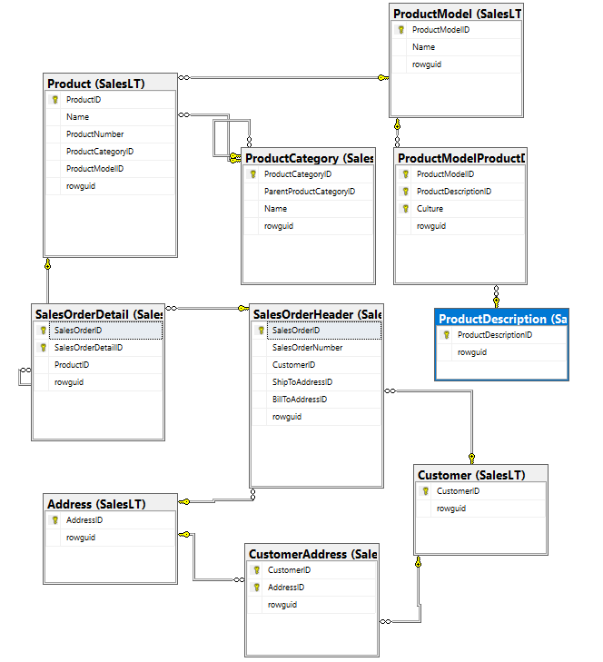

# adventureworks-sql-analysis
# Análisis de ventas con SQL Server (AdventureWorksLT)

Proyecto de análisis de datos en **SQL Server** que responde 6 preguntas de negocio sobre una empresa ficticia que vende bicicletas, componentes, ropa y accesorios. Incluye exploración de la base, diagrama de relaciones y consultas comentadas con sus conclusiones.

## Contexto

Una empresa de bicicletas quiere entender de dónde vienen sus ingresos, qué tan rentables son sus productos y qué parte de su catálogo y de su base de clientes está inactiva. Este proyecto responde esas preguntas usando únicamente SQL.

**Preguntas de negocio:**

1. ¿Qué categorías de producto generan más ingresos? (por categoría y por categoría padre)
2. ¿Cuáles son los 10 productos más vendidos, por ingresos y por unidades?
3. ¿Qué clientes compraron y cuáles nunca?
4. ¿Cómo se reparten las ventas por país y provincia?
5. ¿Cuál es el margen de ganancia por categoría?
6. ¿Qué productos nunca se vendieron?

## Datos

Base de ejemplo **AdventureWorksLT** de Microsoft. Se usan las 10 tablas del esquema `SalesLT`:

| Tabla | Filas | Qué contiene |
|---|---|---|
| Customer | 847 | Clientes |
| Address | 450 | Direcciones |
| CustomerAddress | 417 | Tabla puente entre clientes y direcciones |
| Product | 295 | Productos |
| ProductCategory | 41 | Categorías (con jerarquía padre-hijo) |
| ProductModel | 128 | Modelos de producto |
| ProductDescription | 762 | Descripciones |
| ProductModelProductDescription | 762 | Tabla puente entre modelos y descripciones |
| SalesOrderHeader | 32 | Encabezado de los pedidos |
| SalesOrderDetail | 542 | Líneas de cada pedido |

Diagrama de relaciones:



## Herramientas

- SQL Server (T-SQL)
- SQL Server Management Studio (SSMS)

## Cómo reproducirlo

1. Descargá el backup de **AdventureWorksLT2025** desde el [repositorio de ejemplos de Microsoft](https://github.com/microsoft/sql-server-samples/releases/tag/adventureworks).
2. Restauralo en SSMS: clic derecho en *Databases* → *Restore Database...* y elegí el archivo `.bak`.
3. Abrír `sql/01_exploracion.sql` para ver las tablas y sus filas.
4. Ejecutá `sql/02_consultas_negocio.sql`. Cada consulta tiene arriba la pregunta que responde y abajo su conclusión.

## Hallazgos principales

| Pregunta | Hallazgo |
|---|---|
| Ingresos por categoría | La categoría padre **Bikes concentra el 81%** de los ingresos ($574.611 de $708.690). Touring Bikes lidera con $220.655. |
| Top 10 de productos | El top 10 por **ingresos** son solo bicicletas; el top 10 por **unidades** son ropa y accesorios (lidera Classic Vest, S con 87 unidades). Los productos que más se venden no son los que más ingresan. |
| Clientes | Solo **32 de 847 clientes (3,8%)** compraron, y cada uno hizo un único pedido. |
| Ventas por país | **Reino Unido (Inglaterra) genera el 60%** de los ingresos con 14 pedidos; su ticket promedio es casi el doble que el de Estados Unidos. |
| Margen | Con el costo estándar, el margen total es **negativo (aprox. -$13.456, -1,9%)**. Touring Bikes (-4,2%) y Road Bikes (-10,2%) venden por debajo del costo; los mayores márgenes están en accesorios (hasta 37,7%). |
| Productos sin ventas | **153 de 295 productos (51,9%)** nunca se vendieron. Components concentra 77 de ellos; Accessories tiene la mayor proporción (72,4%). |

## Conclusiones y recomendaciones

- **Dependencia de las bicicletas:** más del 80% de los ingresos viene de un solo rubro, y justamente ese rubro tiene margen negativo o casi nulo.
- **Catálogo inactivo:** más de la mitad de los productos no registra ventas.


## Limitaciones


- El margen se calcula con `StandardCost` (costo estándar por unidad) y varios márgenes repiten el mismo porcentaje, lo que sugiere que los precios de la base se generaron con una fórmula fija.
- `LineTotal` ya incluye el descuento aplicado.
- Para la ubicación de las ventas se usó la dirección de envío (`ShipToAddressID`).

## Habilidades de SQL aplicadas

JOIN de varias tablas, `LEFT JOIN` para detectar registros sin coincidencia, self join (jerarquía de categorías), `GROUP BY` con agregaciones, `CASE`, `COUNT(DISTINCT ...)`, `TOP` y conversión de tipos con `CAST`.

## Estructura del repositorio

```
adventureworks-sql-analysis/
├── README.md
├── sql/
│   ├── 01_exploracion.sql
│   └── 02_consultas_negocio.sql
└── docs/
    └── diagrama_er.png
```

## Autor

**Facundo Juarez**, estudiante de Data Analytics.

- LinkedIn: https://www.linkedin.com/in/facundo-juarez-b8571222a/
- Email:  fjuarez.data@gmail.com
